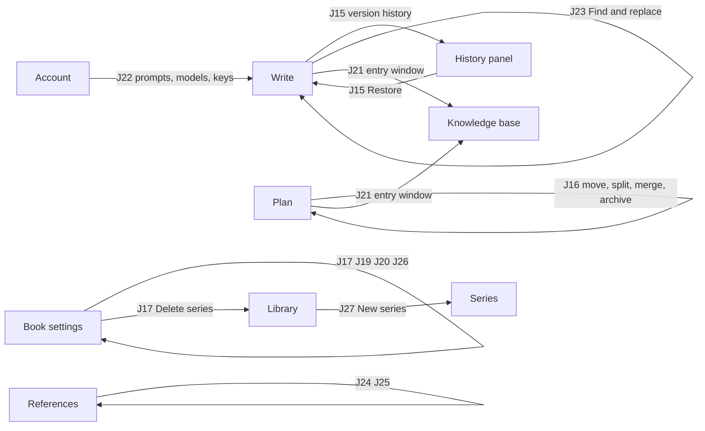

# Journeys J15–J27 (wave 5 authoring)

Slice W5.0 of #23. These thirteen journeys come from the #16 review (section A, *Missing journeys*, with the relevant section B notes). They are written in the format of J1–J14 in #16 Part 2, plus what the review's section D asks for: an **Expect** list per journey and a **Negative path** for every journey that writes data. Joel confirms this document before any wave-5 lane (L13–L20) starts.

Every behaviour this document had to invent is marked **(proposed)**. They are collected in *Proposed decisions to confirm* at the end. Nothing marked (proposed) is built until it is confirmed.

## How to read a journey

- **Lane** is the #23 wave-5 lane that builds the journey and **Test** is its class under `Codex.AcceptanceTests/Journeys/`, as in the #23 wave-5 table.
- Screens are in **bold**, `→` is a move between screens, and indented steps stay on one screen.
- `test-id` names are real ids from `src/Codex.Client/src/features/*/testIds.ts` and `src/testIds.ts`. A step that needs UI which does not exist yet says **(to build, L<n>)** and names the lane. The lane picks the id, with the prefix of the screen it extends (`write-`, `plan-`, `kb-`, `refs-`, `settings-`, `library-`).
- **Reset to seed.** `JourneyTest` clones the seed for each journey class, so no journey depends on another journey's state. Steps inside one journey accumulate: each **Expect** line is checked at the step named, with the numbers that hold at that point. This is the review's section D rule, and it removes the J4 / J10 / J11 / J13 dependencies the review found.
- **Numbers** come from the "Seed landed" comment on #16 and `db/seed/01–08`. Where a number is derived (for example marker numbers after a move) it says *derived*, and the test author checks it against the seed once. Where a number is unknown (the word count of the pending AI draft) the Expect line says how to read it, so the test never hard-codes a guess.
- **Negative paths** are separate `[Test]` methods that start from their own fresh clone (or run last, if they leave the data unchanged). Each says what must *not* be written.
- Tests assert on rows through `ScalarSqlAsync` only for data the UI does not show, as in J1–J14.

### Seed facts used here

| Fact | Value |
|---|---|
| Library | 15 books (6 standalone, 9 in 3 series), 3 series: Forsaken Gods 2,025 words, The Ashen Crown 3,540, Tidewater Chronicles 2,130 |
| Product Engineering (PE) | 13,703 words, 10 chapters, 15 scenes, status writing, target 80,000 |
| PE scenes (words) | Ch 1: 1,840 · Ch 2: 1,210 · Ch 3: 2,650 / 1,980 / 0 · Ch 4: 231 / 0 · Ch 5: 3,120 / 0 (pending draft) · Ch 6: 640 / 0 · Ch 7: 940 · Ch 8: 162 · Ch 9: 520 · Ch 10: 410 |
| References | 12 sources, 11 cited, 4 cleared, 3 risks (Velocity Trap 342 of 300, Team Topologies, Ship It Friday), badge 3, 2 open quote flags |
| PE Knowledge base | 12 entries: Blog Posts 3, Laws 3, Stories 2, Research 2, People 2 |
| PE labels | Ready to write (Ch 1, Ch 2), Drafting (5·1, 6·1, 7·1), Needs research (3·3, 4·1, 5·2), Maybe cut (8·1) |
| Other books | Northbound: 0 chapters. Hymns for Machines: 3 chapters + 1 archived, its Sc 1 links to the archived chapter *The Hymn That Was Cut*. Product Engineering (v1): 1,155 words, 3 chapters, 6 scenes, standalone. Iron Litany: 855 words (seed); about 125,000 words, 30 chapters, 90 scenes with `db/seed-large` |
| Series KB | Forsaken Gods: category Spells (Gravetouch, Hollow Prayer, Ember Ward) and label Playtested. The Ashen Crown: Characters and Places |
| Team Topologies request | `permission_request` status `sent`, sent 16 days ago, `remind_at` 3 days ahead |
| Sign-in | `jd@codex.local` / `codex-dev-password` (`docs/auth.md`), admin |

## Cross-cutting rules (the review's section C)

#23 Q11 had no answer, so the bracketed defaults stand until Joel confirms them here. Three of them are already what the app does; the table says which.

| # | Rule | Behaviour | Status | Tested in |
|---|---|---|---|---|
| R1 | A `ch:` link to an archived chapter | The link keeps working and shows the chapter's current title with an *archived* style. Clicking it opens Plan at the *Archived* list entry for that chapter, which has **Restore**. Nothing is rewritten in the prose. **(proposed)** | Seed holds the case (Hymns for Machines); behaviour not decided | J16 step 9, W4.7 |
| R2 | Deleting a Knowledge base entry that has mentions, `scene_kb`, `beat_kb` or additions | Convert, not block: mentions turn into plain text, scene links and beat context are removed, the entry's timeline notes and their `::kb-addition` lines are deleted, the entry is archived so Undo works. | Built (`DeleteEntryDialog`, `kb_entry_guard_delete`). Needs Joel's confirmation as the rule | J21 step 7 |
| R3 | Moving a scene to another chapter | Beats, KB links, additions, labels and source uses are keyed by scene id and travel with it. Marker numbers follow first use in the new order. A KB addition that now sits after the entry's first use gets a warning on the entry's Timeline tab; the move is never blocked. **(proposed)** | Not built | J16 steps 4–5 |
| R4 | Deleting a source that has uses | Convert, not block (Q11 default): its markers become plain text in Write, the uses are archived, the source is archived. A revision is cut for each changed scene so J15 can undo it. | Built (L19.1): `RemoveSource` posts the archive, which converts the markers and cuts the revisions | J24 step 8 |
| R5 | Archiving a scene that holds the only use of a source | Its uses archive with it. The source becomes *Not cited* and leaves the bibliography; the Cited count and the risk count drop. Restoring the scene brings the uses back and counts them as new since any sign-off (`scene_restore_reopens_signoff`). | Trigger exists. The bibliography and badge assertion is new | J16 step 8 |
| R6 | Concurrent edits to one scene (two tabs, phone and laptop) | Q11 default: last write wins. The tab that did not save sees the *Updated elsewhere* banner. The text it loses is kept as a `prose_revision` (source `replaced`) so J15 can restore it. | Built in L13.2. The editor's save no longer answers 409; block moves, Apply and MCP still do | J18 steps 5–7 |
| R7 | Large books and a book with no chapters | Seed has both (Iron Litany in `db/seed-large`, Northbound). Write, Plan, search and export are exercised on them, with generous timeouts, not tuned budgets. | Seed done | J19, J23 (large); J16 and J19 (empty) |

## Overview

| # | Journey | Lane | Test | Starts on | Ends on |
|---|---|---|---|---|---|
| J15 | Undo an AI apply / restore an earlier version | L13.1 | `J15_RestoreAnEarlierVersion` | Write | Write |
| J16 | Restructure beyond reorder | L14.1 | `J16_RestructureBeyondReorder` | Plan | Plan, checked in Write and References |
| J17 | Delete, archive and restore a book or series | L15.1 | `J17_DeleteArchiveRestoreABook` | Book settings | Library |
| J18 | Recover from a failed save or AI call | L13.2 | `J18_RecoverFromAFailedSave` | Write | Write |
| J19 | Export a manuscript (not for print) | L16.1 | `J19_ExportAManuscript` | Book settings | Export job done |
| J20 | Back up and take my data out | L16.2 | `J20_BackUpAndTakeMyDataOut` | Book settings | Plan of the restored book |
| J21 | Edit and maintain a Knowledge base entry | L17.1 | `J21_EditAndMaintainAKbEntry` | Plan sidebar | Plan |
| J22 | Manage prompt templates and models | L18.1 | `J22_ManagePromptTemplatesAndModels` | Account | Write |
| J23 | Find and replace in the manuscript | L13.3 | `J23_FindAndReplace` | Write | Write |
| J24 | Manage references beyond citing | L19.1 | `J24_ManageReferencesBeyondCiting` | References | References |
| J25 | Permission follow-up | L19.2 | `J25_PermissionFollowUp` | References | References, then Write |
| J26 | Publish lifecycle | L20.1 | `J26_PublishLifecycle` | Book settings | Library |
| J27 | Series management | L15.1 | `J27_SeriesManagement` | Library | Series |

---

## J15 · Undo an AI apply / restore an earlier version

**Goal:** take back an AI draft I applied and a hand edit after it, then bring the draft back.
**Start:** Write at Ch 5 · Sc 2. **End:** Write, prose restored to the chosen version.
**Lane:** L13.1 Scene history. **Test:** `J15_RestoreAnEarlierVersion`.

1. **Write** at `Links.Write(book, scene 5.2)`. The scene has 0 words and a pending Opus draft under the beat. Read the draft's word count N from `write-draft-meta-<target>` (the test records it; N is not hard-coded).
2. Click **Apply** (`write-draft-apply-<target>`). The prose is N words and `prose_revision (source = 'ai_apply')` is cut with `generation_id` set.
3. Type one sentence at the end, `We measured outcomes, not output.` (5 words). The bar goes Unsaved → Saving… → Saved (`editing-save-status`). Prose is N + 5 words.
4. Scene gutter ⋯ → **Version history** (to build, L13.1). A panel opens on the right. It lists newest first, each row with time, source label and word count:
   - *Edited* · N + 5 words (an `autosave` revision)
   - *AI draft applied* · N words · Opus 5.5 · attempt 1 (the `ai_apply` revision, with its model from the generation)
   - *Imported* · 0 words (the seed's `import` revision)
   The panel marks the top row *Current*.
5. Select the *AI draft applied* row. The right side shows a word-level comparison against the current text: the 5 added words are marked and the counter reads `−5 words`.
6. Click **Restore this version**. A confirm line says what will happen (*Replaces the current text with the version from 14:02. The current text stays in history.*). Confirm. The prose is N words, a new revision `source = 'restore'` is cut, a toast offers Undo (`editing-toast-undo`), and the list now has four rows.
7. Click Undo in the toast. The prose is N + 5 words again; the undo is itself a `restore` revision, so history only grows. **(proposed)**
8. Select *Imported* · 0 words → **Restore**. The scene is back to 0 words and the beat line. The draft's three source uses (Goodhart, DORA, Accelerate, all at Ch 5 · Sc 2) are archived, because their links left the prose (`prose_sync_embeds`). The `ai_generation` row stays `applied`. **(proposed:** restoring never makes a draft pending again; apply it again from the beat or restore the *AI draft applied* version.)
9. Select *AI draft applied* → **Restore**. The links are back in the prose and the three uses are live again. A source use that comes back by restore counts as a new use, so a source signed off in between reopens. **(proposed**, same rule as `scene_restore_reopens_signoff`.)
10. **Plan** tab. The Ch 5 · Sc 2 card shows N words.

**Data:** reads `prose_revision`; writes `prose.body` (and `version`), `prose_revision (source = 'restore')`, `reference_use.archived_at` through the trigger. Does not touch `ai_generation.status`.

**Variant: an agent edit.** With an API token (`docs/auth.md`, J-lane test client) an agent edits Ch 7 · Sc 1 through MCP `edit_prose`. The history shows a row *Edited by <client name>* (`prose_revision.source = 'agent'`, `client_name`). Restore it like any other row. **(proposed)** Restore is not blocked while the agent's `undo_id` is still valid; both undo paths write revisions.

**Revision rule.** A revision is cut on Apply, on Restore, on an agent edit, and for the first save after any of those. Further saves within 10 minutes update that `autosave` revision in place, so the list is not one row per keystroke. **(proposed)**

**Expect:**
- After step 2: scene words = N; `prose_revision` count for the scene is 2 (`import`, `ai_apply`).
- After step 3: scene words = N + 5; revision count 3.
- Step 4: three rows in the order above; exactly one row marked *Current*.
- Step 5: comparison shows 5 added words and 0 removed; counter `−5 words`.
- After step 6: scene words = N; revision count 4 and the newest has `source = 'restore'`; toast text contains `Restored`.
- After step 8: scene words = 0; live `reference_use` rows at Ch 5 · Sc 2 = 0 (3 before).
- After step 9: scene words = N; live uses at Ch 5 · Sc 2 = 3.
- Keyboard: ⋯ opens with Enter, rows move with ↑/↓, Esc closes the panel and focus returns to the ⋯ button.

**Negative path:**
- Cancel in the confirm step: no `prose_revision` row is written and the text is unchanged.
- The *Current* row has no Restore button (`disabled`, *This is the current version*).
- Restore on a scene that was edited in another tab since the panel opened: the panel reloads its list first and shows *Updated elsewhere*; the restore then follows R6 (last write wins, the other text is kept as a revision).
- Version history on an archived scene is read-only: rows show, Restore is hidden.

---

## J16 · Restructure beyond reorder

**Goal:** add, rename and move chapters, move a scene to another chapter, split and merge scenes, archive a chapter, and see the rules in R1, R3 and R5 hold.
**Start:** Plan. **End:** Plan, checked in Write and References.
**Lane:** L14.1 Restructure. **Test:** `J16_RestructureBeyondReorder`.

What exists today: **New Act** (`plan-new-act`), **New chapter** (`plan-new-chapter-<act>`), **New scene** (`plan-new-scene-<chapter>`), act rename (`plan-act-rename-<act>`), **Delete act** (`plan-act-delete-<act>`), **Archive scene** (`plan-scene-archive-<scene>`) with the *Archived (n)* list and Restore (`plan-archived-toggle`, `plan-restore-<scene>`), and drag reorder with the grips (`plan-grip-<kind>-<id>`). The steps below say what is new.

1. **Plan** (Product Engineering, 10 chapters, 15 scenes). Act 3 *Practices* → `+ New Chapter` (`plan-new-chapter-<act 3>`), title `Metrics That Mislead`. It becomes **Chapter 11**. `+ New Scene`, summary `Where dashboards go wrong.` Scenes are now 16.
2. Rename Ch 7 *Shipping Small* to `Shipping Small, Safely` (chapter ⋯ → **Rename chapter**, or double-click the title; built, L14.1). The chapter's `slug` stays `shipping-small`. Open **Write** → *About this book*: the chapter reference still reads *§ Chapter 7* (its live number) and its tooltip is the chapter's current title, *Shipping Small, Safely*, because the link stores the chapter, not the words.
3. **Plan.** Move Ch 7 into Act 3: drag its grip onto Act 3, or focus the grip and press Alt+↓ past the act edge (built, L14.1). Act 2 now has 2 chapters, Act 3 has 5, and chapter numbers stay continuous: Ch 7 is still Chapter 7.
4. Move Ch 8 · Sc 1 (*Why We Stopped Estimating*, 162 words, holds a *Velocity Trap* quote) to the end of Ch 3: drag the card onto Ch 3's column, or card ⋯ → **Move to chapter…** → Ch 3 (built, L14.1). It becomes **Ch 3 · Sc 4**. Chapter 8 stays and shows *No scenes*. **(proposed:** an emptied chapter is kept, never deleted for you.)
5. **References.** The *Velocity Trap* row now lists its uses as Ch 3 · Sc 4 and Ch 4 · Sc 1, and its marker number is **3** while *Goodhart* is **4** (first use order: Beck 1, Manifesto 2, Velocity Trap 3, Goodhart 4; *derived*). Quoted words are still 342 of 300 and the status is still Copyright risk. Quote flag f2 now reads *Ch 3 · Sc 4*.
6. **Plan.** Split Ch 1 · Sc 1 (*Preface*, 1,840 words): **Write** → place the caret at the start of a paragraph → `/` → **Split scene here** (built, L14.1; it was *New scene from here*). The scene becomes Sc 1 (first part) and Sc 2 (second part). Their word counts add up to 1,840. The first part keeps the summary and label; the second part gets an empty summary, copies of the labels and of the `scene_kb` links, and the beats, additions and source markers that sit below the caret. **(proposed)**
7. Merge Ch 3 · Sc 1 and Sc 2: card ⋯ on Sc 2 → **Merge into previous scene** (built, L14.1). Sc 1 now has 2,650 + 1,980 = 4,630 words, the *Manifesto* quote use now belongs to the merged scene (**References** → Used in the book shows Ch 3 · Sc 1) and its marker is still **2**. The summaries are joined with a blank line, labels and KB links are combined, and the absorbed scene is archived, not deleted, so Undo works. **(proposed)** *Archived (1)* now lists it.
8. **Plan.** Chapter ⋯ → **Delete chapter** on Ch 10 (built, L14.1; it archives). Toast: *Chapter archived · 1 scene · 1 source use*. **References:** *Ship It Friday* is **Not cited** and is gone from the Bibliography view; Cited sources 10; risks 2; the bar's References badge reads 2. Undo (the toast) → everything is back (Ship It Friday cited, badge 3).
9. **Hymns for Machines** → **Write**, Sc 1. The link to *The Hymn That Was Cut* (an archived chapter) still reads `The Hymn That Was Cut`, styled as archived with the tooltip *This chapter is archived*. Click it → **Plan** with the *Archived* list open at that chapter (R1). **(proposed)** The text of the link and the prose are unchanged.
10. **PE Plan.** Archive Ch 10 · Sc 1, then archive Ch 10 itself (no live scenes). In *Archived*, **Restore** the scene. A prompt says *Its chapter Where to From Here is archived. Restore the chapter too?* → **Restore both**. **(proposed)** Declining leaves the scene archived. Words are back to 13,703 and the badge to 3.

**Data:** `act`, `chapter` (`act_id`, `position`, `title`, `archived_at`; `slug` never changes), `scene` (`chapter_id`, `position`, `archived_at`), `prose.body` (split and merge), `scene_label`, `scene_kb`, `reference_use.scene_id` (moves with split and merge), `reference_use.archived_at` (R5).

**Expect:**
- Step 1: chapter heading `Chapter 11`; PE has 11 chapters and 16 live scenes (SQL); words 13,703.
- Step 2: `chapter.slug` is `shipping-small`; the Write reference text contains `Shipping Small, Safely`.
- Step 3: `plan-act-meta` for Act 2 reads 2 chapters, Act 3 reads 5; Ch 7 heading still `Chapter 7`.
- Step 4: scene is `Ch 3 · Sc 4`; Ch 3 words 2,650 + 1,980 + 0 + 162 = 4,792; Ch 8 words 0; PE total 13,703.
- Step 5: marker numbers Velocity Trap 3, Goodhart 4, Conway 5 (unchanged); quoted words 342 of 300.
- Step 6: two scenes where one was; words add to 1,840; scene count 17; `scene_kb` rows for the second part equal the first part's.
- Step 7: merged scene 4,630 words; `reference_use.scene_id` of the Manifesto use is the surviving scene; *Archived (1)*; live scenes 16.
- Step 8: Cited sources 10, risks 2, `shell-references-badge` = 2, PE words 13,293 (13,703 − 410); after Undo 13,703, badge 3.
- Step 9: link text equals the chapter title; link has the archived marker; click lands on Plan with `plan-archived-list` visible.
- Step 10: both restored; Ship It Friday cited again.
- Keyboard: grip focus + Alt+←/→ moves a chapter (J4), Alt+↑/↓ moves a scene within its chapter, and across a chapter edge into the next chapter (to build, L14.1); the dialog in step 10 returns focus to the Restore button.

**Negative path:**
- Rename a chapter to empty text: the heading reverts and an inline error says the title cannot be empty. No `chapter` row changes.
- Rename two chapters to the same title: allowed; the second gets slug `…-2` from `set_slug`. The `ch:` link of the first still resolves to the first.
- Archive the only act of **Northbound**: refused with *A book needs at least one act* (`act_keep_one`); nothing changes.
- Press Esc during a drag: the drop line vanishes, no `position` changes.
- Merge Ch 5 · Sc 1 with Ch 5 · Sc 2 (which has a pending draft): blocked, *Apply or discard the draft first*. **(proposed)** Merge Ch 6 · Sc 1 into a different chapter's scene: the menu offers only the previous scene in the same chapter.
- Move a scene onto its own chapter: no-op, no write.
- Declining step 10's prompt leaves the scene in *Archived*.

---

## J17 · Delete, archive and restore a book or series

**Goal:** archive a book and bring it back, delete a book for good, and delete a series without losing its books.
**Start:** Book settings. **End:** Library.
**Lane:** L15.1 Book and series lifecycle. **Test:** `J17_DeleteArchiveRestoreABook`.

Exists today: Settings → **Archive & export** has **Archive…** (`settings-archive`, dialog `settings-archive-dialog`, confirm `settings-archive-confirm`), the archived bar and **Restore** (`settings-archived-bar`, `settings-restore`) and a toast with Undo. New here: the Library's archived list, permanent delete, and delete series.

**A: archive and restore**
1. **Library** → *Undertow* (Tidewater Chronicles, Book 002, 1,095 words, Writing) → Plan → **Book settings** `#archive` (`shell-tab-settings`).
2. **Archive…** → dialog → confirm. Toast: *Undertow archived.* with Undo. The bar shows *This book is archived: hidden from Library and the palette. Nothing was deleted.* The book keeps its series slot as an archived book.
3. **Library.** The Tidewater stack badge reads 1 (was 2). Open the stack: **Series** shows 1 book and 1,035 words (was 2 books, 2,130 words). **(proposed:** archived books are left out of series totals.) The palette (⌘K, `library-palette-input`) finds nothing for `undertow`.
4. Open Undertow by its URL. Plan and Write show an *Archived* banner with **Restore**, and prose is read-only. **(proposed; not built in L15.1: only Book settings shows the archived bar today)**
5. Library toolbar → status filter (`library-status-filter`) → **Archived** lists Undertow flat (not inside its stack) with **Restore** (`library-restore-<book>`). **Restore.** It returns to Tidewater as Book 002 (its number was kept). The stack badge reads 2 again.

**B: delete a book for good**
6. **Library** → *Product Engineering (v1)* → Book settings → Archive it (as in 2).
7. Library → **Archived** → the book's row ⋯ → **Delete permanently…** (`library-book-menu-<book>` ⋯ → `library-delete-book-<book>`). The dialog says what goes (*3 chapters, 6 scenes, 1,155 words, 0 sources*), links *Export source first* (Book settings → Archive & export; J20) and asks you to type the title (`library-delete-book-title`). **Delete** stays disabled until the title matches. **(proposed:** only an archived book can be deleted; there is no trash period.)
8. Confirm. The book is gone from every list and the palette. `book` rows with that id are 0, and so are its `act`, `chapter`, `scene`, `prose`, `kb_entry`, `reference` rows (`ON DELETE CASCADE`). *Product Engineering* is untouched; its `copied_from_id`, if it pointed here, is set to NULL.

**C: delete a series**
9. **Library** → Forsaken Gods stack → **Series** → settings (`library-series-settings`) → **Delete series…** (`library-series-delete`). The dialog reads *Its 3 books become standalone. The series' Knowledge base (Spells, 3 entries) and labels (Playtested) are copied onto each book first.* Confirm.
10. **Library.** The stack is gone. Players Guide, Gamemaster's Codex and Bestiary of the Fallen are on the Standalone shelf. Each has its own *Spells* category with Gravetouch, Hollow Prayer and Ember Ward, and the label *Playtested*. (`copied_from_id` points at the series' entry, which is deleted with the series, so the schema's `ON DELETE SET NULL` clears it again.) Players Guide's `::spell` blocks point at its own copies (Layout preflight still passes).

**Data:** `book.archived_at`; `DELETE FROM book` with cascade; series: each book's `series_id` set NULL (fires `book_copy_down_series_scope`), then the series row deleted. A series cannot be deleted while it has books (schema), so the app detaches first.

**Expect:**
- Step 2: `book.archived_at` not null; Library tile count 14 (was 15); `settings-archived-bar` visible.
- Step 3: Tidewater `library-stack-count` 1; series stats `library-series-stat-books` 1 and `library-series-stat-words` 1,035; palette empty (`library-palette-empty`).
- Step 5: `archived_at` null again; `series_number` 2; stack count 2; series words 2,130.
- Step 8: Library tile count 14 (15 after the restore in step 5, minus the deleted book); SQL row counts for the book are 0.
- Step 10: Standalone shelf has 9 books (was 6); series stacks 2 (was 3); each of the three books has 3 `kb_entry` rows in `Spells`; `publication_settings` of the series filled the books' empty values.
- Keyboard: every dialog traps focus, Esc cancels, and focus returns to the control that opened it.

**Negative path:**
- Cancel in the archive dialog: `archived_at` stays null.
- Type a different title in step 7: Delete stays disabled; no rows are removed.
- Delete is not offered on a book that is not archived; the API answers 409 for it. **(proposed)**
- Cancel in the delete-series dialog: books stay in the series.
- Archive a book while a print export job is running: blocked with *An export is running for this book*. **(proposed)**

---

## J18 · Recover from a failed save or AI call

**Goal:** never lose prose to a dropped connection, a server error, two tabs or a failed generation.
**Start:** Write. **End:** Write, text intact.
**Lane:** L13.2 Recovery. **Test:** `J18_RecoverFromAFailedSave`.

Exists today: the save bar states *Unsaved*, *Saving…*, *Saved*, *Conflict* and *Updated elsewhere* (`editing-save-status`, with `editing-save-status-reload`), draft panel **Stop** (`write-draft-stop-<target>`) and error (`write-draft-error-<target>`). New here: the offline queue, the retry control, the replaced-by-another-tab rule (R6) and the specific generation error texts.

**A: offline**
1. **Write** → Ch 7 · Sc 1 (940 words). Browser context goes offline. Type ` Batch size is the strategy.` (5 words).
2. The bar reads *Unsaved*, then *Offline · 1 change waiting* (to build, L13.2). The text stays in the editor and is also kept in local storage under the scene id. **(proposed)** Closing the tab warns *You have changes that are not saved*.
3. Back online. The bar goes Saving… → *Saved* with no click. Server prose is 945 words; `prose.version` is up by one.

**B: server error**
4. Route the save call to answer 500. Type 3 words. The bar reads *Unsaved · Retry* and a Retry button appears. Remove the fault, click **Retry** → *Saved*. 948 words.

**C: two tabs (R6)**
5. Open Ch 7 · Sc 1 in tab 1 and tab 2. In tab 2 type 3 words → Saved (B + 3 words, where B is what parts A and B left: 948). Tab 1 (no edits yet) shows *Updated elsewhere* with **Reload**.
6. In tab 1, without reloading, type 4 words. Tab 1's save is accepted: last write wins, the bar says *Saved*. Tab 1's text is the stored text (B + 4 words). Tab 2 shows *Updated elsewhere* and its own B + 3 word text is kept as a `prose_revision` labelled *Replaced by another session* (built, L13.2; see J15). The 409 / *Conflict · Reload* path is gone for the editor's own save.
7. Tab 2 **Reload** → shows tab 1's B + 4 words.

**D: generation errors**
8. **Write** → Ch 3 · Sc 3 (*Bad Scrum*, beat 600 words) → **Generate prose** with no AI provider connected. Main's per-user AI integrations (#36 / PR #71) cover this step: the draft panel shows *Connect an AI provider in Settings*, linking to `/settings/ai` (`NoProviderConnectedTests`). The beat text and its context are unchanged and no prose is written. Not built in L13.2.
9. With the provider answering 429, the panel shows `Rate limited. Try again in 30 s` and **Retry** is disabled until the countdown ends. **(proposed)**
10. With a working provider: Generate, and click **Stop** (`write-draft-stop-<target>`) after the caret appears. The partial text is kept as a pending draft marked `Stopped · N words`; **Apply**, **Retry** and **Discard** all work on it. `ai_generation.status = 'pending'`, `output` holds the partial text. The *Stopped* mark is kept on this page only (a reload shows the draft as an ordinary pending one). **(proposed)**

**Data:** `prose.body`, `prose.version`, `prose_revision` (replaced text), `ai_generation (status failed | pending, output, input_tokens, output_tokens)`.

**Expect:**
- Step 2: `editing-save-status` text is `Offline · 1 change waiting`; local storage key for the scene exists.
- Step 3: status `Saved`; word count 945; no duplicated text.
- Step 4: status `Unsaved · Retry` then `Saved`; 948 words.
- Step 5: tab 1 status `Updated elsewhere`.
- Step 6: stored word count B + 4 (tab 1 loaded B and never saw tab 2's three words); a `prose_revision` with B + 3 words exists; tab 2 status `Updated elsewhere`.
- Step 8: covered by #71's `NoProviderConnectedTests`.
- Step 9: `write-draft-error-<target>` reads `Rate limited. Try again in N s`, Retry is disabled, the `ai_generation` row for the beat is `failed` and the scene still has 0 words.
- Step 10: draft meta reads `Stopped`; Apply puts the partial text in the prose and the scene word count equals the draft's count.

**Negative path:**
- Apply a draft while offline: the apply fails with *Not applied. You are offline*, the draft stays pending, prose is unchanged.
- Navigating away with unsaved changes asks to stay; choosing Stay keeps the editor as it was.
- Generation with a beat that is empty: Generate is disabled and no `ai_generation` row is written.

---

## J19 · Export a manuscript (not for print)

**Goal:** a Word, Markdown or EPUB copy of the manuscript for an editor or beta readers.
**Start:** Book settings. **End:** an export job succeeded with a download.
**Lane:** L16.1 Manuscript export. **Test:** `J19_ExportAManuscript`.

Exists today: Settings → **Export source** queues a `source` job (`settings-export-source`, `settings-export-status`); the Layout screen has exports for print. New here: the **Export manuscript** dialog and three job kinds. `export_job.kind` only allows `proof`, `print`, `source`, and a non-source job must have a template version (`export_job_template_ck`), so L16.1 adds a migration `<stamp>_L16_manuscript_export.sql` that adds `docx`, `markdown`, `epub` and relaxes the template check for them (additive).

1. **Product Engineering** → Book settings → **Archive & export** → **Export manuscript…** (`settings-export-manuscript`; built in L16.1). **(proposed:** also in Write's ⋯ menu; **not built**, that menu is the Write lane's.) The dialog opens on *Word (.docx)*, *Full manuscript*, both toggles off, and says *3 sources are at risk. This export is not gated.*
2. Choose **Format** *Word (.docx)*, **Scope** *Full manuscript*, **Include beats** off, **Include summaries** off. Click **Export**.
3. A job row appears under the button: *Queued* → *Running* → *Done · product-engineering.docx* with a **Download** link. The list polls while a job is live (it does not wait for the events), so a reload keeps it.
4. Open the file: 10 chapter headings (`Chapter N: Title`, level 2), 3 act headings (level 1), no `::` directive text, no `[^](ref:…)` text. With Chicago, source markers become footnotes, one per live use; with APA or Harvard they become `(Author Year, locator)`. A *Bibliography* (level 1) of the cited sources ends the file. Scene headings move down two levels. **(proposed)**
5. Repeat with **Markdown**, scope *Chapter 6 · Discovery is Everyone's Job* (a chapter picker appears and **Export** stays disabled until one is picked). The file holds only that chapter, with no act heading: 640 words, counted over the scene text only (not the title block, headings, footnote markers or bibliography).
6. Repeat with **EPUB**, summaries on and beats on. Each scene starts with its summary in italics; each beat's instruction is a block quote starting `Beat:`. The EPUB opens (zip with `mimetype` first, `nav.xhtml`, one XHTML page per chapter, one per act title and one for the bibliography: 14 pages here).
7. Export **Players Guide** as Markdown. The job row lists what the file left out: `1 raw-LaTeX block skipped`. Figures are not in these formats (an image is not exported), so a book with figures also lists `N figures not included`. **(proposed; changed from "1 figure (low resolution) included")**
8. Export a manuscript while References has risks. The dialog shows *3 sources are at risk. This export is not gated.* and proceeds. **(proposed)** Only Export for printer is gated (J12).

**Variant: large book.** Iron Litany (with `db/seed-large`, about 125,000 words, 30 chapters): Markdown, full scope, completes with the 90 scenes in order (R7).

**Data:** `export_job (kind, settings, status, step, progress, output_asset_id, error)`, `asset` for the file. Prose is read, never changed.

**Expect:**
- Step 3: `export_job` row with `kind = 'docx'`, `status = 'succeeded'`, `output_asset_id` set; the list item says `Done`.
- Step 4: heading count = 10 chapter headings + 3 act headings + the bibliography (derived); footnote count = live `reference_use` rows excluding pending draft uses (SQL, `archived_at IS NULL AND generation_id IS NULL`); no text matches `ref:` or `::`.
- Step 5: `markdown_word_count` of the file's scene text = 640; exactly one chapter heading.
- Step 6: EPUB file lists 14 content documents; with beats on, beat blocks = `beat` rows not archived in the book that have text.
- Step 7: the job's notes contain `raw-LaTeX`.
- Step 8: no print gate message (the dialog only states the count).
- Whole book, Markdown, beats and summaries off: word count of the scene text = 13,703 (the Library figure).

**Negative path:**
- Export **Northbound** (0 chapters): the dialog says *Nothing to export. This book has no chapters.* and **Export** is disabled; the API answers 422 `blocked` the same. No job row (R7).
- A second export of the same kind while one runs: **Export** is disabled with *An export is already running*; `export_job_live_document_uq` (one live job per book and kind, for `docx`, `markdown` and `epub`) answers 409 to a second request; Export source checks the same in the app. **(proposed)**
- A failed job (the renderer fails): the row shows *Failed* and the error text and has **Retry**; Retry opens the dialog on the same format, and **Export** makes a new row. (Scope and toggles are not remembered.)
- Cancel the dialog: no `export_job` row.
- Scope *Chapter* with no chapter picked: **Export** disabled.

---

## J20 · Back up and take my data out

**Goal:** a full backup of one book that Codex can import again, and proof that nothing is lost on the way back.
**Start:** Book settings. **End:** Plan of the restored book.
**Lane:** L16.2 Backup round trip. **Test:** `J20_BackUpAndTakeMyDataOut`.

Exists today: **Export source** (`settings-export-source`) queues a `source` job and says *Codex can import it again*; the worker that builds the file is a TODO in `ArchiveSection.tsx`. `book_import.source` already allows `codex_zip`. New here: the zip contents, the job finishing, and the Import dialog reading it (`library/importSources.ts` has no *Codex backup* option yet).

1. **Product Engineering** → Book settings → **Export source** → **Export .zip** (one click, no dialog: the button's text says pending AI drafts and images are not included). **(proposed:** a confirm dialog; **changed**, because Layout's and Settings' existing tests click the button once.)
2. The job runs (`settings-export-status` follows it: *Export queued.* → *Export running.* → *Export succeeded.*, polled). **Download** (`settings-export-download`) the zip. Under the status, `settings-export-notes` lists what was left out: *1 pending AI draft is not included · 0 images not included*. The button is disabled while the job is live.
3. The zip holds **(proposed layout)**:
   - `book.json` (title, author, status, target, series name, citation style and publication settings, `formatVersion: 1`)
   - `structure.json` (acts, chapters, scenes with the `file` that holds each one's prose, beats, and the scene and beat links to Knowledge base entries; column names as the database has them)
   - `manuscript/act-01-<slug>/chapter-01-<slug>/scene-01.md`, one file per live scene, beats and additions as directives, `[passage](ref:<id>)` and `[name](kb:<id>)` links kept
   - `knowledge-base.json` (categories, entries with aliases and fields, related links, additions)
   - `references.json` (sources with their sign-off and fair-use dates, uses with ids, permission requests, quote flags with their decisions)
   - `labels.json` (labels and which scenes carry them)
   - `manifest.json` (title, author, format version, the scene files in order)
   - Not in it: images (`assets/` is **not built**), archived acts, chapters and scenes, prose history, pending AI drafts and their source uses, layout settings, link-check results, the source history.
4. **Library** → **Import** (`library-import`) → choose **Codex backup (.zip)** (to build, L16.2; `library-import-source-codex_zip`) → pick the file → Next. Step 2 of the dialog shows the mapping: `13,703 words`, and rows for 10 chapters, 15 scenes, 12 Knowledge base entries, 12 sources, 10 cited sources and 4 labels. (Cited is 10, not 11: the pending draft's uses are not in the backup, so *2024 State of DevOps Report* has none.)
5. Import. The new book is titled `Product Engineering` with the suffix ` (restored)` when a book with the title exists. **(proposed)** Plan opens with the import banner (`import-banner`) showing the same counts (*3 acts, 10 chapters, 15 scenes and 13,703 words, plus 12 Knowledge base entries, 12 sources (10 cited) and 4 labels.*).
6. Check the restored book: **References** reads 5 of 10 cited sources cleared, 3 risks, badge 3 (sign-offs and the Team Topologies request come back; *Accelerate* is cleared here because the draft use that reopened it is not restored), Write shows 12 markers (the original's 15 less the draft's 3), Knowledge base sidebar has 12 entries. **(proposed:** a backup restores sign-offs and permission requests; Duplicate (J26) does not.)

**Data:** `export_job (kind = 'source')`, `asset` (zip), `book_import (source = 'codex_zip', mapping, result)`, then everything the import creates: `book`, `act`, `chapter`, `scene`, `prose`, `beat`, `kb_*`, `reference*`, `label`, `scene_label`. Prose history is not exported, so the restored book has one `import` revision per scene. **(proposed)**

**Expect:**
- Step 2: `export_job.status = 'succeeded'`; zip lists 15 `.md` files plus the JSON files.
- Step 4: mapping line matches the counts above (words from `markdown_word_count`).
- Step 6: `book_stats` for the new book: 13,703 words; 10 chapters and 15 scenes (rows); `reference_clearance` shows the same status per source as the original except the three the pending draft touched (*2024 State of DevOps Report* not cited, *Accelerate* cleared, *Problems of Monetary Management* one use); marker `ref:` ids resolve to `reference_use` rows of the new book.
- Source book is unchanged after the import.

**Negative path:**
- Import a file that is not a Codex backup (`notes.zip` with no `book.json`): step 2 shows *This is not a Codex backup: it has no book.json.* and **Import book** stays disabled; no `book_import` row reaches `importing`.
- Import a backup whose `format version` is newer: *This backup was made by a newer Codex.*
- Cancel in the dialog: no `book_import` row (the preview writes nothing) and no `book` row.
- Export source for a book while an export of it runs: the button is disabled and the status reads *Export running.*; the API answers 409.

---

## J21 · Edit and maintain a Knowledge base entry

**Goal:** rename, recategorise, merge and delete entries, maintain categories and labels, and see what follows each change.
**Start:** Plan sidebar. **End:** Plan.
**Lane:** L17.1 Knowledge base maintenance. **Test:** `J21_EditAndMaintainAKbEntry`.

Exists today: the entry window with name, aliases, category chip, *always in context*, related entries, Used-in and Timeline tabs, **New category** and **Delete** with an impact line (`kb-entry-window`, `kb-entry-name`, `kb-alias-input`, `kb-always-in-context`, `kb-category-chip`, `kb-new-category-open`, `kb-related-add`, `kb-entry-menu` → `kb-entry-menu-delete`, `kb-delete-dialog`). New here: rename effects, alias collision handling, merge, category edit and delete, label management.

Built in L17.1 (ids): rename line `kb-rename-keep-alias`, **Rename anyway** `kb-rename-anyway`, **Add anyway** `kb-alias-add-anyway`, alias warning `kb-alias-warning`, entry menu **Merge into…** `kb-entry-menu-merge` with `kb-merge-dialog`, `kb-merge-option-<id>`, `kb-merge-message`, `kb-merge-confirm`; the category heading ⋯ `kb-category-menu-<id>` (rename, colour, **Delete category…**; the book's own categories only); the label filter's **Manage labels…** `plan-manage-labels` (rename, delete with count, add). A new entry named like another entry's name or alias is refused with **Create anyway** (`kb-entry-draft-create-anyway`). Not in this journey as built: the step 4 check that Generate sends Kent Beck's entry (the AI draft panel is the AI lane's), the *Undo restores mention chips* wording is covered by the delete test (mentions are restored as links).

1. **Plan** → sidebar → *Goodhart's Law* (Laws) opens the entry window (`#entry=`). Rename to `Goodhart's Law (metrics)` (`kb-entry-name`). A line offers *Keep "Goodhart's Law" as an alias* (on by default). **(proposed)** The slug `goodharts-law` does not change (`e:goodharts-law`). Mentions in prose keep the words the author typed; summary chips render the new name.
2. Alias: add `Goodhart` (already there) → error. Add `Conway` → blocked, *Conway is also an alias of Conway's Law* (`kb-alias-error`), with **Add anyway**. **(proposed:** same `ambiguous` rule as MCP `upsert_kb_entry`.) Add `law` → warning *Matches 14 other words in the book. Underlines every "law".* **(proposed:** warn at 3 letters or fewer, or 25 or more matches, but allow.)
3. Category chip → *Research*. The entry moves to the end of Research; Laws now lists 2, Research 3; the Write underline colour changes to Research's.
4. **Kent Beck** → switch on **Always in context** (`kb-always-in-context`). The hint reads the approximate token cost. In Write, Generate in Ch 3 · Sc 3 (J5): the saved `ai_generation.request` lists Kent Beck's entry id.
5. **Related:** on Goodhart open **Related** → **Add** (`kb-related-add`) → pick *Conway's Law* (`kb-related-option-<id>`). A chip appears on both entries (`kb_entry_link`, stored once, ordered).
6. **Merge:** sidebar `+` in Research → new entry `DORA metrics` (summary `The four delivery metrics.`). Drag it onto the Ch 5 · Sc 1 card (`scene_kb`). Then its ⋯ → **Merge into…** → *DORA Four Keys* (to build, L17.1). The dialog lists what moves: *1 scene link, 0 additions, 0 related. "DORA metrics" becomes an alias.* Confirm. DORA Four Keys' Used-in tally reads **1 scene** (Ch 5 · Sc 1; the seed gives DORA Four Keys no scene links; `kb-used-in-tally`), `DORA metrics` is an alias, and the sidebar is back to 12 entries. The merged entry is archived. Its `kb:` links, `kb_progression`, `beat_kb` and `reference.kb_entry_id` rows are repointed to the target. **(proposed** merge rules: the target keeps its own summary and body; a non-empty body of the source is appended under *Merged from DORA metrics*.)
7. **Delete (R2):** sidebar → *Goodhart's Law (metrics)* → ⋯ → **Delete**. The dialog (`kb-delete-message`) reads *It is used in 2 scenes. Mentions turn into plain text, links and beat context are removed, and 1 timeline note is deleted.* Confirm. A toast offers Undo. Ch 4 · Sc 1's summary shows `Goodhart's Law` as plain text (the chip is gone), its `::kb-addition` line is gone and its words are still 231. Undo restores the entry, its links, context and note. **(proposed** Undo restores mention chips.)
8. **Categories:** `Blog Posts` → rename to `Blog` (heading menu, to build, L17.1); change its colour. **Delete** an empty category: create `Temp` (`kb-new-category-open`) then delete it. Deleting `Laws` (with entries) is blocked: *Move or delete its 2 entries first.* **(proposed)**
9. **Labels:** open the Plan label filter (`plan-label-filter`) → **Manage labels** (to build, L17.1). Rename *Drafting* to `In progress`; the cards of Ch 5 · Sc 1, Ch 6 · Sc 1 and Ch 7 · Sc 1 show the new name. Delete *Needs research*: the dialog reads *Used on 3 scenes. Deleting removes it from them.* Confirm. The label is gone from the filter and from Ch 3 · Sc 3, Ch 4 · Sc 1 and Ch 5 · Sc 2.
10. **Timeline** tab of the restored *Goodhart's Law (metrics)* lists its 1 addition (Ch 4 · Sc 1) in book order, the view the review asks for in J8 (*what does the reader know by chapter N*). When additions exist in several scenes, a move in J16 changes this order.

**Data:** `kb_entry` (name, `aliases`, `category_id`, `always_in_context`, `archived_at`), `kb_category`, `kb_entry_link`, `scene_kb`, `beat_kb`, `kb_progression`, `label`, `scene_label`, `reference.kb_entry_id`, `prose.body` (mention unwrap on delete, rewrite on merge).

**Expect:**
- Step 1: `kb_entry.slug = 'goodharts-law'`; `aliases` contains `Goodhart's Law`; Plan Ch 4 · Sc 1 chip text is the new name.
- Step 2: `kb-alias-error` visible for `Conway`; no alias row added until **Add anyway**.
- Step 3: sidebar section counts Laws 2, Research 3.
- Step 4: `always_in_context = true`; the next `ai_generation.request` contains the entry id.
- Step 5: both entries show the chip; one `kb_entry_link` row with `entry_a_id < entry_b_id`.
- Step 6: Used-in tally `1 scene`; sidebar entry count 12; source entry `archived_at` set; no `scene_kb` rows left on the archived entry.
- Step 7: sidebar Research count 3 → 2 after Delete → 3 after Undo (Goodhart was moved there in step 3); `kb_progression` for Ch 4 · Sc 1 archived then restored; Ch 4 · Sc 1 words 231 throughout.
- Step 9: `scene_label` rows for *Needs research*: 3 before, 0 after; label count 3.
- Keyboard: Esc closes the entry window and focus returns to the sidebar item; dialogs trap focus.

**Negative path:**
- Rename to empty text: `kb-entry-error`, name unchanged.
- Rename to the name of another entry in scope (`Conway's Law`): blocked as ambiguous, **Rename anyway** available. **(proposed)**
- Create an entry named `DORA` (an alias of DORA Four Keys): `kb-entry-draft-error` explains; no row is written until confirmed.
- Create a category named `Laws`: `kb-new-category-error` (`kb_category_name_uq`).
- Create a label named `Maybe cut`: duplicate error (`label_name_uq`).
- Cancel in the delete dialog (`kb-delete-cancel`): nothing changes. Cancel in the merge dialog: no rows move.
- Merge an entry into itself: the target list does not offer it.

---

## J22 · Manage prompt templates and models

**Goal:** write my own prompt template, connect a model provider and choose its default model, then draft with the new template.
**Start:** Settings → AI. **End:** Write, generating with the new template.
**Lane:** L18.1 Prompt templates (reconciled with #36 / PR #71, AI integrations). **Test:** `J22_ManagePromptTemplatesAndModels`.

`GET /api/prompts` lists the built-in templates (files under `prompts/`, read-only, *Continue writing*, *Write in Joel's voice* and
*Paraphrase*) plus the user's own `prompt_template` rows (L18.1 lane migration). Models are not L18.1's: they come from the user's AI
integrations (#36, [ai-integrations.md](ai-integrations.md)), each with its own key, base URL and default model; `prompts/models.json`
only suggests labels. Both live on **Settings → AI** (`/settings/ai`): *AI providers* (#71) and, under it, *Prompt templates* (L18.1).

1. **Settings → AI** (user menu → AI). *Prompt templates* lists 3 rows, each showing *Built in*, with no edit control (Duplicate only).
2. *Continue writing* → **Duplicate**. Name it `Joel's voice (nonfiction)`. The body opens in an editor with variables `{{beat}}`,
   `{{context}}`, `{{style_guide}}`, `{{previous_prose}}`, `{{length}}` and a token estimate for the template alone. Save.
3. Edit `Joel's voice (nonfiction)`: change the instruction, Save. Older `ai_generation.request` snapshots keep their old text; only new
   generations use the change.
4. *AI providers* → **Connect** → *OpenAI-compatible*: label `Gateway`, an `https://` base URL, a key → **Test connection** lists the
   gateway's models → choose `gpt-test` → Save. The row shows the key hint only and *Default*. On Write, the beat's template · model
   button reads `gpt-test`, and the picker offers 4 templates.
5. On the *Gateway* row: **Test** (caches its models), then **Change default model** → `gpt-test-mini`. The Write picker ticks
   `gpt-test-mini` under *Gateway*, and a beat with no model chosen uses it.
6. **Write** → Ch 3 · Sc 3 → on the beat choose template `Joel's voice (nonfiction)` and model `gpt-test-mini` → **Generate**. After it ends,
   **Show what was sent** opens a popover with the template name, the model and the integration (`gpt-test-mini (Gateway)`), the context
   entries by name, the input and output token counts and the instruction and prompt exactly as sent.

**Data:** `prompt_template` insert and update, an `ai_integration` row (#36), `ai_generation.request` / `model` / `integration_id` for the
generation.

**Expect:**
- Step 1: 3 template rows, all *Built in*.
- Step 2: 4 rows; one `prompt_template` row.
- Step 3: the new body is stored, and the next generation's prompt carries it.
- Step 4: the page never contains the full key; `ai_integration.credential` is encrypted; Write offers 4 templates.
- Step 5: `ai_integration.default_model` is `gpt-test-mini`, ticked in the picker.
- Step 6: `ai_generation.model` is `gpt-test-mini`; the gateway was sent the filled template; the popover shows the token counts and the prompt.

**Negative path** (`J22_ManagePromptTemplatesAndModels_Negative`):
- Duplicate name for a template: inline error, no row.
- Empty body: Save disabled, *The prompt cannot be empty*. A body without `{{beat}}` saves with a warning *The model will not see the beat*.
- Edit a built-in template: no edit control; **Duplicate** only.
- Cancel an edit: no write.
- A model server on a local `http://` address (`http://localhost:11434/v1`): *Use an https:// address.*, nothing saved, unless the
  server owner sets `CODEX_AI_ALLOW_LOCAL_ENDPOINTS=true` (#36's base URL rules).

Dropped with #71 (L18.1 had built them before #71 merged): L18's own models table, the Anthropic key on Account, the default-model
setting across built-in and local models, its connection tester, the per-model prices (and so the cost in the popover), *Not tested*,
and the delete-model rules (*Choose another default first*, *2 beats use this model*). #71's integrations cover keys, defaults, testing
and deletion instead.

---

## J23 · Find and replace in the manuscript

**Goal:** rename a person and a term across the book without damaging quotes or links.
**Start:** Write. **End:** Write.
**Lane:** L13.3 Find and replace. **Test:** `J23_FindAndReplace`.

Exists today: the toolbar's *Find in manuscript* (`write-find`, `write-find-count`): case-insensitive highlight of what is rendered, Enter and Shift+Enter step, Esc clears. It searches prose only and cannot replace. New here: a replace field, the scope switches, searching the whole book (including chapters not currently rendered), and the rules for markers and mentions.

1. **Write** → Find (`write-find`) → `Kent Beck`. Count: 1 match (Ch 3 · Sc 1, inside a mention). Open **Replace** (to build, L13.3), type `Kenneth Beck`.
2. Options (in the **Replace** panel under the find box): **Search in** *Prose* (on), *Summaries*, *Beat instructions*; *Match case*; *Whole word*; *Include archived scenes* (off). **(proposed:** defaults as listed; no regular expressions in v1.)
3. **Replace all.** A toast reads *Replaced 1 in 1 scene* with Undo. The mention's text now reads `Kenneth Beck` and still links to the entry (the `kb:` target is not changed). The Kent Beck KB entry is not renamed (J21). The Ch 3 · Sc 1 summary chip `@Kent Beck` is by id and is not text, so it is not touched. **(proposed)**
4. Find `teams` with scope Chapter 9 (Scope selector, `write-scope-select`). Count: 2 matches, both inside the *Conway* paraphrase marker in Ch 9 · Sc 1. Type replacement `groups`. They show a lock and **Replace all** reports *Skipped 2 inside cited quotes*. Text inside `[…](ref:…)` is never changed, because the marker's words are the quoted or paraphrased passage. **(proposed)** Nothing changes, and no revision is cut. (Built: the matches are listed in the Replace panel with *Locked: inside a cited passage*, and Replace all is disabled when nothing can be replaced.)
5. Find `teams` over the *Full manuscript*: the count is every whole-word `teams` in the book's prose, *derived* from `prose.body`; three are locked (Ch 3 · Sc 1 sits inside the Beck paraphrase marker as well, so the seed has no unlocked match there; Ch 9 · Sc 1 has the two above). Pick an unlocked match in the Replace panel and press *Replace* (this match only), then *Next*.
6. Tick **Summaries**. Find `design the teams`: the Ch 9 · Sc 1 summary matches (plain text; the seed's summary is set to *We design the teams first.* by the test), and so does the *Conway* marker (locked). Replace all changes the summary and leaves the marker alone.
7. A pending AI draft contains matches (Ch 5 · Sc 2). The panel counts them (*N in a pending draft. Replace all skips them.*) and Replace all leaves the draft's text alone. **(proposed)**
8. Toast Undo (or J15 history) restores every scene touched by the last Replace all as one action. **(proposed:** one `prose_revision (source = 'manual')` per changed scene, grouped by the toast.)

**Variant: large book.** Open Iron Litany (with `db/seed-large`) → Find a word from the filler vocabulary (for example `outcome`). The count comes back for all 30 chapters, not only the rendered ones, and Replace all finishes on 90 scenes without freezing the page (R7).

**Data:** `prose.body` (and word count, `version`), `prose_revision`, `scene.summary`, `beat.body` when those scopes are on. `ref:` and `kb:` targets and `::` directives are never touched.

**Expect:**
- Step 1: `write-find-count` text contains `1`.
- Step 3: scene body contains `[Kenneth Beck](kb:<uuid>)`; Ch 3 · Sc 1 word count unchanged at 2,650; a `prose_revision` row exists for the scene.
- Step 4: scene body is byte-identical to the seed's; revision count unchanged; toast text contains `Skipped 2`.
- Step 5: the one chosen unlocked match is replaced and the book's whole-word `teams` count drops by one.
- Step 6: summary text changed; the `ref:` link text unchanged.
- Step 7: draft output unchanged.
- Step 8: after Undo, the touched scenes' bodies equal their state before the replace.
- Occurrence counts in other scenes are computed in the test with the same whole-word regexp over `prose.body`, never typed in.

**Negative path:**
- Empty find: Replace all disabled.
- No matches: *No matches*, count `0`, nothing to replace.
- Replacement equal to the search text: Replace disabled.
- Esc closes the bar without changing text.
- Replace in a scene another session changed: follows R6.
- A replacement that would break a mention (for example a search text spanning a link boundary): the match is shown but skipped as *Spans a link*. **(proposed)**

---

## J24 · Manage references beyond citing

**Goal:** import sources, fix a source, un-cite, merge a duplicate, change a use's type, and delete a source with uses.
**Start:** References. **End:** References.
**Lane:** L19.1 References management. **Test:** `J24_ManageReferencesBeyondCiting`.

Exists today: **Add source** (`refs-add-open`) with ISBN, DOI and URL lookup, *Use existing source*, manual entry, **Import** (`refs-add-import-open`, `refs-add-import-dialog`), source details editing and **Re-check**, use-type select, **Remove** a source (`refs-panel-menu-remove`), and in Write the marker card's **Remove** (`write-cite-remove`). Built in L19.1: CSL JSON import and the import preview, **Merge into…** (`refs-panel-menu-merge`), the reopen on edit, and the Q11 deletion behaviour with revisions. The use-type select (`refs-use-kind-<use>`) already worked outside the AI path. Zotero is supported by importing its CSL JSON or BibTeX export; there is no live Zotero link in v1. **(proposed)**

1. **References** (12 rows) → **Add source** → **Import** → pick `library.json` (CSL JSON) with 4 items: *Fowler, Refactoring (2018)*, *Kim, The Phoenix Project (2013)*, one item that is already in References (*Accelerate*, matched by ISBN: the seed's Accelerate has none, so the test records `9781942788331` on it first) and one with no title. The summary (`refs-add-import-summary`) reads `2 new · 1 already in References · 1 skipped (no title)`, from a server preview (`POST …/references/import/preview`) that writes nothing. The skipped items are listed (`refs-add-import-skipped`) each with its reason. The import button is disabled when the preview holds nothing new.
2. **Import.** Result (`refs-add-import-result`): `2 added`. Sources are 14 with *Not cited* for both; `external_provider` is `zotero` for the new rows (CSL JSON is Zotero's export; BibTeX rows are `bibtex`, RIS `ris`); `reference_event` has `action = 'added'`, `source = 'import'` for each.
3. **DOI lookup:** Add source → DOI `10.1109/MS.2019.2940016`-style value (the lookup fake returns a fixture) → **Look up** (`refs-add-lookup`) adds the source from the fixture and opens its panel with the DOI filled in (no separate Save). A DOI the fake does not know shows `refs-add-not-found` and offers manual entry.
4. **Edit and reopen:** *Conway, How Do Committees Invent?* (Cleared) → Source details (`refs-details`) → change the year from 1968 to 1967 → status becomes *Needs check*, History reads *reopened the source: details changed since sign-off*, and Cleared drops from 4 to 3. **(proposed:** any edit of a cited field reopens a sign-off, as a new use does.) History (`refs-history`) has an item for the edit.
5. **Merge duplicates:** add `Accelerate` by hand without an ISBN (a duplicate). Its panel menu → **Merge into…** (to build, L19.1) → *Accelerate*. The dialog says *1 source's details and 0 uses move; the duplicate is archived.* The target keeps its own details and takes missing fields from the duplicate; `merged_into_id` is set. **(proposed)** Live source count back to 15 (14 after step 2, 15 after the DOI source in step 3, 16 with the duplicate).
6. **Change a use's type:** *Beck, Extreme Programming* (Cleared, Paraphrase at Ch 3 · Sc 1) → Used in the book → use kind (`refs-use-kind-<use>`) → *Quote*. Quoted words become the excerpt's word count, and the status is *Needs check*, reason *New uses since cleared* (`reference_use_touch`). Change it back to *Paraphrase*: quoted words 0; the source stays Needs check until you sign off again, as shortening does not reopen but also does not clear.
7. **Un-cite:** **Write** → Ch 9 · Sc 1 → the *Brooks* marker (quote, 10 words) → marker card → **Remove** (`write-cite-remove`). The passage stays as plain text, the use is archived, *Brooks* is **Not cited**, Cited sources goes from 11 to 10 and the *Ship It Friday* marker renumbers from 11 to 10 (R5; first-use order, *derived*).
8. **Delete a source with uses (R4):** **References** → *Whitlock, The Velocity Trap* (2 uses, risk) → panel menu → **Remove** → confirm text *Its 2 markers become plain text in Write.* Confirm. The source is archived, the two passages stay as plain text in Ch 4 · Sc 1 (231 words) and Ch 8 · Sc 1 (162 words), quote flag f2 loses its suggested source, the risk count drops to 2 and the badge to 2. A revision is cut for each changed scene (J15 can undo it).

**Data:** `reference` (insert, update, `merged_into_id`, `archived_at`, `external_provider`, `external_key`), `reference_use` (`kind`, `archived_at`), `reference_check` (DOI), `reference_event`, `prose.body` and `prose_revision` (unwrap), `quote_flag.reference_id`.

**Expect:**
- Step 1: summary text as above; nothing is written until **Import**.
- Step 2: `reference` count 14 live; 2 new `reference_event` rows with `source = 'import'`.
- Step 3: the panel shows the fixture's title and the DOI; the unknown DOI shows `refs-add-not-found` and writes nothing.
- Step 4: `refs-row-status` for Conway reads *Needs check*; `refs-cleared-text` reads `3 of 11 cited sources cleared`.
- Step 5: live source count 15 again; duplicate `merged_into_id` equals Accelerate's id.
- Step 6: quoted words for Beck equal the excerpt's word count while *Quote*, 0 after.
- Step 7: `refs-cleared-text` denominator 10; Ship It Friday `refs-row-number` is 10.
- Step 8: `shell-references-badge` = 2; `markdown_word_count` of Ch 4 · Sc 1 unchanged at 231; no `ref:` link to the removed uses remains in the book.

**Negative path:**
- Import with no file: **Import** disabled. A file that is not CSL JSON, BibTeX or RIS: `refs-add-import-problem` says what could not be read; no rows written.
- Look up an ISBN already in References: the form offers *Use existing source* (`refs-add-use-existing`) and writes nothing.
- Edit a source's year to text: inline error, no write.
- Merge a source into itself: not offered. Merge a source that has a live permission request into one that also has one: blocked, *Both have a permission request. Withdraw one first.* **(proposed)** (`permission_request_live_uq`).
- Cancel the remove dialog (`refs-remove-cancel`): the source and its markers stay.
- Remove a marker from a scene another tab changed: follows R6.

---

## J25 · Permission follow-up

**Goal:** chase a permission request, record the reply, and deal with a refusal.
**Start:** References. **End:** References, then Write.
**Lane:** L19.2 Permission follow-up. **Test:** `J25_PermissionFollowUp`.

Seed: *Team Topologies* (Book, Figure at Ch 9 · Sc 1) has a request sent 16 days ago with `remind_at` 3 days ahead. Exists today: the Permission section (`refs-permission`, `refs-perm-status`, `refs-perm-remind-label`, **Granted** `refs-perm-granted`, **Refused** `refs-perm-refused`, grant and refuse forms, **Withdraw**, attachment row). New here: due reminders surfaced on the screen, snooze, follow-up text, attachment removal, and the refused-to-cut path.

Arrange in the test: set `remind_at` to one day ago in SQL (time is database-stamped, D4).

1. **References.** The summary strip shows a chip *1 reply overdue* (to build, L19.2). The *Team Topologies* row shows *Reminder due* (`refs-row-reminder`). **(proposed:** the reminder is computed on load, not pushed by email.) The References badge is still 3.
2. Open the source. Permission: `Asked 3 Oct · no reply`, `Reminder due`. **Remind me again in** 3 days / 7 days (`refs-perm-remind-in-3`, `-7`; sets `remind_at` from the server's clock, clears the chip). **Copy follow-up** puts a short polite chaser with the original request date on the clipboard; **Mark followed up** sets `last_reminded_at`. **(proposed)**
3. **Reply: Granted.** `refs-perm-granted` → form (`refs-perm-grant-form`): attach `grant.pdf` (`refs-perm-file`), credit line `Reprinted by permission of IT Revolution`, terms `One edition, print only`, fee optional (`refs-perm-fee-input`). The letter file is required (the server answers 400 without one). Submit. Status: *Granted 19 Oct* and the risk lifts to **Needs check** (signing off is its own click, as in J10); risks 3 → 2, badge 2, the strip reads `2 risks block print export`. The fee is kept in `fee_amount`. The credit line appears in the Bibliography (`refs-bib-credit`). History has *Permission granted*.
4. **Replace the letter:** remove the attachment (✕ `refs-perm-attachment-remove`, then confirm `refs-perm-attachment-confirm`), then attach `grant-v2.pdf` (`refs-perm-attach-input`). One live `reference_attachment` row remains; the replaced letter stays archived.
5. In a second run from a fresh clone: **Reply: Refused.** `refs-perm-refused` → note `Declined: not licensing figures` → Submit. Status stays *Copyright risk · Permission refused 19 Oct* and the verdict's next action (`refs-verdict-cut`) reads *Cut or replace the figure*.
6. **Cut:** the action's link opens **Write** at Ch 9 · Sc 1 with the marker card open (`write-marker-card`) → **Remove** (`write-cite-remove`). *Team Topologies* is **Not cited**; risks 3 → 2; the request stays on file as `refused`.
7. **Ask again** (after refusal): a new draft is allowed because only `draft`, `sent` and `granted` are live (`permission_request_live_uq`).
8. For the lyric (*Ship It Friday*, no request): **Draft request** → **Mark sent** → set a reminder in 14 days → the row shows *Reminder due in 14 days*.

**Data:** `permission_request` (`status`, `responded_at`, `remind_at`, `last_reminded_at`, `credit_line`, `terms`, `fee_amount`), `reference_attachment (kind = 'permission_letter')`, `reference_event`, `reference_use.archived_at` for step 6.

**Expect:**
- Step 1: chip text `1 reply overdue`; `shell-references-badge` = 3.
- Step 2: `remind_at` in the future; chip gone; `last_reminded_at` set after Mark followed up.
- Step 3: `permission_request.status = 'granted'` with `responded_at`; `refs-row-status` Needs check; `refs-cleared-text` still `4 of 11 cited sources cleared`; `shell-references-badge` = 2; one `permission_letter` attachment linked to the request.
- Step 4: attachment count 1.
- Step 5: `status = 'refused'`; row status still *Copyright risk*; badge 3.
- Step 6: Team Topologies Not cited; badge 2; Cited 10.
- Step 7: a `draft` row is created next to the `refused` one.

**Negative path:**
- Remind me with a date in the past: rejected, `remind_at` unchanged.
- Grant form with a negative fee: inline error (`refs-perm-form-error`), status stays `sent`. Without a file the submit is disabled. **(proposed:** the credit line is optional; the file is required, as built.)
- Cancel the grant form: status stays `sent`, no attachment.
- Draft a second request while one is `sent`: **Draft request** is not offered (`permission_request_live_uq`).
- **Withdraw** the sent request: status `withdrawn`, the risk stays, and the reminder chip is gone.
- Refuse without a note: allowed. **(proposed)**

---

## J26 · Publish lifecycle

**Goal:** move a book to Published with a snapshot of what was published, then start a second edition or a copy.
**Start:** Book settings. **End:** Library.
**Lane:** L20.1 Publish lifecycle. **Test:** `J26_PublishLifecycle`.

Exists today: status segments (`settings-status-<planning|draft|writing|revising|published>`, `StatusSegments.tsx`), **Duplicate…** (`settings-duplicate`, dialog, `duplicate_book`), **Export source**. Today the status only changes by clicking the segment. New here: the Published confirmation, the snapshot list and the second-edition action.

1. **Series** *Tidewater Chronicles* shows `library-series-stat-published` = 1 (Saltmarsh). **Undertow** (Writing) → Book settings → status **Published** (`settings-status-published`).
2. A dialog opens: *Mark Undertow as published? Words: 1,095. 0 sources at risk. A snapshot of the manuscript is saved.* Confirm. **(proposed:** Published warns about open risks but does not block; the print gate stays on Export for printer.)
3. Status shows Published; the snapshot appears under *Snapshots (1)*: `Published · 19 Oct 2026 · 1,095 words · Download`. **(proposed:** a snapshot is an `export_job` of kind `source` with `settings.snapshot = true` and a label, so no new table. It is the J20 zip.) Edits remain possible; the Library tile shows *Edited since publication* once the manuscript changes after the snapshot. **(proposed:** Published does not lock editing.)
4. **Series** page: Published stat is 2.
5. **Product Engineering** (Writing) → Book settings → status **Published** with risks open: the dialog says *3 sources are at risk. The book can be marked published, but Export for printer stays blocked.* Confirm.
6. **Archive & export** → **Start a new edition…** (to build, L20.1; the dialog title `settings-duplicate-title` defaults to `Product Engineering (2nd edition)`). Create. A new book is created from `duplicate_book`: 10 chapters, 15 scenes, 13,703 words, status Planning, `copied_from_id` set. **(proposed:** unlike plain Duplicate, a new edition also copies the sources, with sign-offs and permission requests cleared, and re-wraps the markers. A pending AI draft is not copied, so its uses are not either: References show 12 sources, 10 cited, 0 cleared, 3 risks.)
7. **Duplicate…** (plain, `settings-duplicate`) title `Product Engineering (copy)` on the original. The new book has no sources: References is empty, the badge is hidden, markers are plain text, words are 13,703. (This is what *Product Engineering (v1)* is.) `settings-duplicate-done` links to it.
8. Move *Undertow* back from Published to **Revising**: allowed without confirmation; the series Published stat is 1 again.

**Data:** `book.status`, `export_job` (snapshot), `asset`; `duplicate_book(...)` rows for copies; `reference` and `reference_use` rows for step 6.

**Expect:**
- Step 3: `book.status = 'published'`; one `export_job` with `kind = 'source'` and `settings.snapshot` true, `status = 'succeeded'`.
- Step 4: `library-series-stat-published` reads `2`.
- After step 7: once `book.last_edited_at` passes the snapshot, the Product Engineering tile shows `library-edited-since-publication`; the Undertow tile does not. Library counts are asserted as +1 and +2 against the count before, not as 16 and 17.
- Step 6: new book `book_stats` 13,703 words, 10 chapters, 15 scenes; `copied_from_id` is PE; Library tile count 16; `refs-cleared-text` reads `0 of 10 cited sources cleared`.
- Step 7: reference count 0; Library tile count 17 after both copies.
- Step 8: published stat 1.

**Negative path:**
- Cancel the Published dialog: status unchanged, no snapshot.
- New-edition title empty: `settings-duplicate-confirm` is disabled (as for Duplicate); no book created.
- Mark **Northbound** (0 chapters) as Published: blocked, *Nothing to publish. Add a chapter first.* **(proposed)**
- Snapshot while another source export runs: the dialog waits and says *Waiting for the running export*.
- Duplicate cancelled (`settings-duplicate-cancel`): no book created.

---

## J27 · Series management

**Goal:** make a series from standalone books, reorder it, share Knowledge base entries across it, and take a book out.
**Start:** Library. **End:** Series.
**Lane:** L15.1 Book and series lifecycle. **Test:** `J27_SeriesManagement`.

Exists today: the Series screen with a settings dialog (name, description, order list with grip and up/down, `library-series-settings`, `library-series-order`, `library-series-move-up-<book>`), **+ Add book**, and in Book settings the Series section with a series select, number select and the move review dialog (`settings-series-select`, `settings-number-select`, `settings-move-dialog`, `settings-move-confirm`). New here: creating a series from existing books, series-level Knowledge base editing from a book, and promote.

1. **Library** → ⌘K → **New series…** (`library-palette-action-new-series`) or the toolbar **New series** button (`library-new-series`). Dialog: name `Product Engineering Editions`, pick books from the Standalone list: *Product Engineering (v1)* then *Product Engineering*. They get Book 001 and Book 002 in the order picked. **(proposed)** Create stays on the Library.
2. Create. **Library**: Standalone has 4 books (was 6), a new stack with badge 2. Open it: **Series** header 2 books, 14,858 words (13,703 + 1,155), 0 published.
3. **Reorder:** settings dialog → move *Product Engineering* up (`library-series-move-up-<book>`) → Save. PE is Book 001 and v1 is Book 002; both numbers are valid because the unique check is deferred.
4. **Promote an entry:** open *Product Engineering* → sidebar → *Conway's Law* → ⋯ → **Move to series** (`kb-entry-menu-promote`, confirm `kb-promote-confirm`). The entry's scope badge reads *Series*. In *Product Engineering (v1)* the sidebar now lists *Conway's Law* under Laws (0 entries before, 1 now). **(proposed)** Mentions and links in PE keep working because they store the entry id; the Used-in tally still reads 2 scenes (*derived*). PE's own sidebar count stays 12.
5. **Edit at series level:** open *Players Guide* (Forsaken Gods) → sidebar → *Gravetouch* (Spells, scope Series). Change its summary. Open *Gamemaster's Codex* → *Gravetouch*: it shows the new summary (one row, three books). Rename the series label *Playtested* to `Table-tested`: it changes in all three books' label pickers.
6. **Detach:** *Gamemaster's Codex* → Book settings → Series → **None** (`settings-series-select`). The review dialog (`settings-move-dialog`) says *Spells (3 entries) and Table-tested are copied onto this book.* Confirm. The book is standalone, has its own Spells and label (`copied_from_id` set), and Forsaken Gods now has 2 books. The move closes the gap, as the built move dialog says (*Renumber the later books*): Bestiary goes from Book 003 to Book 002. (The proposal said no renumbering; the app as built renumbers, so the doc follows the app.)
7. **Add to a series:** *Saltwater Ledger* (standalone) → **Series** → *Product Engineering Editions*. It joins as the next number, Book 003 (`settings-number-select` then reads 003). The move dialog confirms; its same-named labels merge into the series labels (`book_join_series`).

**Data:** `book.series_id`, `book.series_number`, `kb_entry.book_id` (promote), `kb_category` (series category created if absent), copy-down inserts on detach, `label`.

**Expect:**
- Step 2: `book.series_id` equal for both; `library-series-stat-books` 2; `library-series-stat-words` 14,858; Standalone shelf 4.
- Step 3: `series_number` PE 1, v1 2.
- Step 4: `kb_entry.book_id` of Conway's Law = the series id; PE sidebar total entries 12; v1 sidebar 1; PE `scene_kb` rows for the entry unchanged.
- Step 5: one `kb_entry` row for Gravetouch; changed summary seen from the second book.
- Step 6: Gamemaster's Codex `series_id` NULL; its Spells category has 3 entries; Forsaken Gods `library-series-stat-books` 2; Bestiary `series_number` 2.
- Step 7: series books 3; `series_number` 3.
- Keyboard: the order list works with the up and down buttons (no drag needed); dialogs return focus.

**Negative path:**
- New series with an empty name: `library-series-name-error`; no row written.
- Create a series with no books chosen: allowed, it is empty and shows *Add a book*. **(proposed)** Create one with a name that already exists: allowed with a notice (titles are not unique, as `book.title`).
- Promote an entry whose name matches one in the series: the dialog offers **Merge into the series entry** (J21 merge) or **Cancel**; nothing is written until chosen.
- Set a duplicate number in Book settings: `settings-number-error`, no write. (Not testable in the UI: the number picker only lists positions in the order, so a taken number cannot be chosen.)
- Cancel the move dialog (`settings-move-cancel`): `series_id` unchanged.
- Detach a published book from a series that has a printed order: the order list warns (`settings-order-published-warning`).

---

## Section B items and where they went

| Review item | Where |
|---|---|
| J1 Retry, Discard and Undo as steps; book changed on another device | Wave 4 (W4.1) steps for Retry and Discard; stale-device case is J18 step 6 (R6) |
| J4 permanent delete of an archived scene; Restore after the chapter changed | Restore with an archived chapter is J16 step 10. **Permanent delete of an archived scene is not written (decision D5 below)** |
| J4 Alt+↑/↓ for scenes; Plan label filter; Outline editing | Alt+↑/↓ in J16 Keyboard. Label filter in J21 step 9. Outline-view editing is left to the L2 tests |
| J5 stop, failure, what was sent | J18 (stop, failure), J22 step 7 (what was sent) |
| J7 delete chip and entry; alias collisions | J21 steps 2, 7 |
| J8 reverse view by chapter; entry detail | Entry window exists (#18). By-chapter view is the Timeline tab, J21 step 10 |
| J9 edit and remove a marker; copy and paste prose with markers; marker in a moved or archived scene | Remove: J24 step 7. Moved or archived scene: J16 steps 5 and 8. **Copy and paste of marked prose is not written (decision D6)** |
| J10 / J11 Refused and Edit use | Refused: J25. Edit a use: J24 step 6 |
| J12 blocked gate | Wave 4 (W4.4) negative path of J12 |
| J13 second device | Decision D7 |
| J14 no results; series and book with one name; ⌘K on book screens | Wave 4 (W4.4); the shell has ⌘K on every screen already (`docs/navigation.md`) |

## Decisions: could have / decide

Each has a recommendation. They are the review's "Could have" items.

| # | Item | Recommendation |
|---|---|---|
| D1 | **Progress and goals** (daily words, streaks, session history). Library already shows words against target. | Out of v1. When wanted, derive daily words from `prose_revision` word counts (J15 keeps them), so no data is lost by waiting. |
| D2 | **J0 first run** (sign-in, empty Library, empty References, empty Knowledge base). Sign-in exists (`docs/auth.md`, Auth lane tests). | Write J0 as a thin journey on an empty database (no seed): wrong password error, sign in, `library-empty`, **Create novel** → Plan with one empty act. Add it to the auth lane in wave 5; it is cheap and needs a fixture with no seed. |
| D3 | **G11 Chat and Review.** #23 Q3: hidden. | Keep them hidden and write no journey. "Review before print" is the Export for printer gate (J12) plus Layout preflight. "Continuity check against the KB" is better as an agent job over MCP. Revisit after v1. |
| D4 | **Cross-book reuse** (copy a scene or entry to another book). | Defer. Duplicate (J26), new edition (J26) and promote to series (J27) cover the real cases. If it comes back, build *Copy to book…* for Knowledge base entries first. |
| D5 | **Permanent delete of an archived scene or chapter.** | Not in v1; archived items stay. Revisit with a *Delete archived* action once books get big. |
| D6 | **Copy and paste prose that contains markers.** | Pasting inside one scene keeps the markers' use ids; pasting into another scene converts the markers to plain text. Add a test in L12's lane rather than a journey. |
| D7 | **Scope, Format and Focus on a second device** (J13). | Per device (local storage), as proposed in J13. State this in `design/README.md`. |
| D8 | **Images and covers** (see the coverage matrix: nothing writes `figure`, `asset`). | Add a J28 *Add an image and a cover* before L7's print pipeline is declared done. |
| D9 | **Agents over MCP** (`change_set`, `api_token`). | The L9 lane tests cover them. If Joel wants a user-visible journey, add J29 *Review what an agent changed* (history rows from J15 plus Undo). |

## Coverage matrix (schema tables against J1–J27)

Tables are from `db/schema/0001_tables.sql` and `db/migrations/*.sql`. W = a journey writes it from the UI (or a trigger a journey fires), R = a journey reads or asserts it. Views are read-only and are not listed. **No writer** in the last column is a flag.

| Table | Writers | Readers | Flag |
|---|---|---|---|
| `app_user` | none of J1–J27 (sign-in updates `last_login_at`; users are managed in `/settings/users`) | all (avatar, `created_by`) | **No writer.** Covered by Auth lane tests; D2 adds J0 |
| `book` | J3, J17, J20, J26, J27 | J1, J2, J14, J17, J26, J27 | |
| `asset` | J3 (import file), J19, J20, J26 (export files), J25 (letters) | J12 | Only files made by jobs and attachments. **No writer for images and covers** (D8) |
| `asset_rendition` | none | J12 (preflight) | **No writer.** Made by L7's worker for uploads (D8) |
| `act` | J3 (default act), J16 | J4, J16 | |
| `chapter` | J3, J4, J16, J20 | J4, J13, J16 | |
| `scene` | J3, J4, J6, J16, J20 | J4, J16 | |
| `prose` | J1, J5, J6, J9, J13, J15, J16, J18, J20, J23, J24 | J1, J19 | |
| `beat` | J5, J6, J16, J20, J23 | J5 | |
| `figure` | none | J12 (low-dpi preflight) | **No writer.** Only the seed inserts figures (D8) |
| `ai_generation` | J1, J5, J10, J18, J22 | J1, J15, J22 | |
| `prose_revision` | J1, J5, J15, J16, J18, J23, J24 | J15 | Review's gap closed by J15 |
| `kb_category` | J7, J21, J27 | J2, J21 | |
| `kb_entry` | J7, J20, J21, J27 | J8, J21 | |
| `kb_entry_link` | J21 (Related, merge) | J21 | Written only in J21 |
| `scene_kb` | J7, J16, J21, J27 | J8 | |
| `beat_kb` | J5, J7, J21 | J5 | |
| `kb_progression` | J7, J16, J21 | J8, J21 | |
| `label` | J6 (picker create), J21, J27 | J4, J21 | |
| `scene_label` | J1, J6, J16, J21 | J4 | |
| `licence` | none (reference data seeded by the schema) | J9, J11, J24 | By design, static |
| `reference_kind` | none (reference data) | J9, J24 | By design, static |
| `publication_settings` | J12, J17, J27 | J10, J12 | |
| `reference` | J9, J11, J20, J24 | J9, J10, J12, J24 | |
| `reference_use` | J1, J4, J9, J10, J11, J16, J24, J25 | J8, J10, J24 | |
| `permission_request` | J10, J25 | J10, J25 | |
| `reference_check` | J9, J11, J24 | J11 | |
| `reference_attachment` | J25 (`permission_letter`, with removal) | J10 | **Kinds `web_archive` and `source_text` have no writer** |
| `reference_event` | J10, J11, J24, J25 | J10 (History), J24, J25 | The review expected no reader; J10, J24 and J25 now assert History |
| `quote_flag` | none (status updates only: J11) | J11 | **No inserter among the journeys.** Flags are created by the scan after a save; only J11 resolves them |
| `layout_template` | none | J12, J26 | **No writer** for user templates (fork, upload) |
| `layout_template_version` | none | J12 | **No writer** (upgrade preview, publish a version) |
| `book_layout_template` | J12 (template choice), J26 (copied by duplicate) | J12 | Template upgrade and trim change are not written |
| `book_layout` | J12 (template choice) | J12 | |
| `export_job` | J12, J19, J20, J26 | J12, J19 | `proof` kind has no journey |
| `book_import` | J3 (variant), J20 | J3 | |
| `asset_rendition_job` | none | none | **No writer.** Worker side effect of image upload (D8) |
| `change_set` | none (MCP and UI undo) | J15 variant | **No UI writer** (D9) |
| `api_token` | none | none | **No writer.** Account → Agent access, covered by Auth lane tests (D9) |
| `data_protection_key` | J22 (created at first key use) | J22 | Infrastructure |
| `prompt_template` (new, L18.1) | J22 | J5, J22 | New table, a lane migration |
| `ai_integration` (#36, PR #71) | J22 | J5, J22 | Replaces L18.1's `model_endpoint` |

Findings:
- **Closed by J15–J27:** `prompt_template` (new table, J22; models are #36's `ai_integration`), `prose_revision` reads (J15), `reference_event` reads (J10, J24, J25), `reference_attachment` removal (J25), `kb_entry_link` (J21), series and book lifecycle (J17, J26, J27).
- **Still without a writer:** `figure`, `asset_rendition` and `asset_rendition_job` and image `asset` rows (D8), `layout_template` and `layout_template_version` (user templates), `quote_flag` inserts, the `web_archive` and `source_text` attachments, `app_user` and `api_token` (auth lane), `change_set` (MCP lane). The review also named `book_layout` editing: J12 step 6 writes the template choice; upgrading a template version or changing the trim has no journey.

## Proposed decisions to confirm

Grouped by journey. Each is marked **(proposed)** in the text above.

- **R1** Archived-chapter link keeps the title, shows archived, opens Plan's Archived list.
- **R3** Moving a scene never blocks; KB addition order warning on the Timeline tab.
- **R4** Source delete cuts a revision per changed scene.
- **R6** Last write wins; the lost text is kept as a revision labelled *Replaced by another session*; removes today's *Conflict · Reload*.
- **J15** Revision cut on Apply, Restore, agent edit and the first save after; later saves within 10 minutes update one `autosave` revision. Undo of a restore is another restore. Restoring never re-opens a draft. A restored use reopens a sign-off. Restore is allowed on agent edits.
- **J16** Emptied chapters stay. Split copies labels and KB links, moves markers and beats below the caret. Merge appends prose, joins summaries, unions labels and links, archives the absorbed scene. Merge blocked with a pending draft. Restore of a scene offers to restore its archived chapter too.
- **J17** Archived books are left out of series totals; archived books are read-only with a Restore banner; only archived books can be deleted, with typed title and no trash period; delete series detaches books first (copy-down); archive is blocked while a print export runs.
- **J18** Local storage keeps unsaved text offline; beforeunload warning; *Unsaved · Retry*; rate-limit countdown; Stop keeps the partial draft; a failed row cannot be reopened.
- **J19** Export manuscript lives in Settings → Archive & export and Write's ⋯; footnotes in the book's style plus a bibliography; not gated by clearance; Players Guide result lists skipped raw LaTeX; one live manuscript export per book and kind; new `export_job` kinds via migration.
- **J20** Zip layout and format version; pending drafts and revision history not exported; restore brings back sign-offs and permission requests; ` (restored)` title suffix. As built: no confirm dialog (the button's text carries the note), no `assets/`, the restored book is standalone (series name is information only) and keeps no layout choice.
- **J21** Rename keeps the old name as an alias (on by default); alias collisions blocked with Add anyway; short or common alias warning; merge rules; category delete blocked while it has entries; Undo of entry delete restores mentions.
- **J22** Templates live on Settings → AI beside #71's AI providers; built-in templates are duplicate-only; variable names; `{{beat}}` warning; models, keys and local endpoint rules are #36's; "what was sent" popover with the integration and tokens (no cost: integrations carry no prices).
- **J23** Default scopes and options, no regex; locked inside `ref:` markers; mention text replaced but target kept; spans-a-link skipped; pending drafts skipped; Undo as one action.
- **J24** Zotero via CSL JSON or BibTeX export only; editing a cited field reopens a sign-off; merge keeps the target's details and takes missing fields; merge blocked when both have a permission request.
- **J25** Reminders computed on load, no email; snooze, follow-up text and Mark followed up; refused note optional; file and credit line optional.
- **J26** Published warns but does not block; a snapshot is a `source` export job; Published does not lock editing; new edition copies sources with sign-offs cleared; Northbound cannot be published.
- **J27** Picked order sets book numbers; empty series allowed; detach does not renumber; promote flow and merge on collision.
